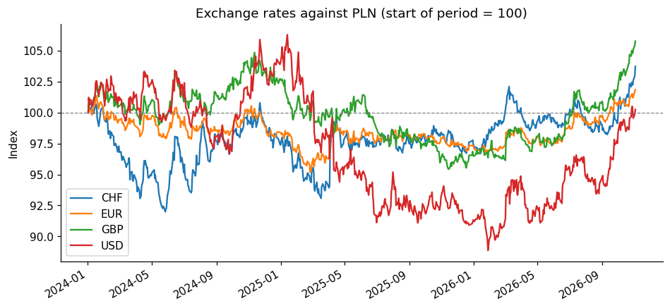
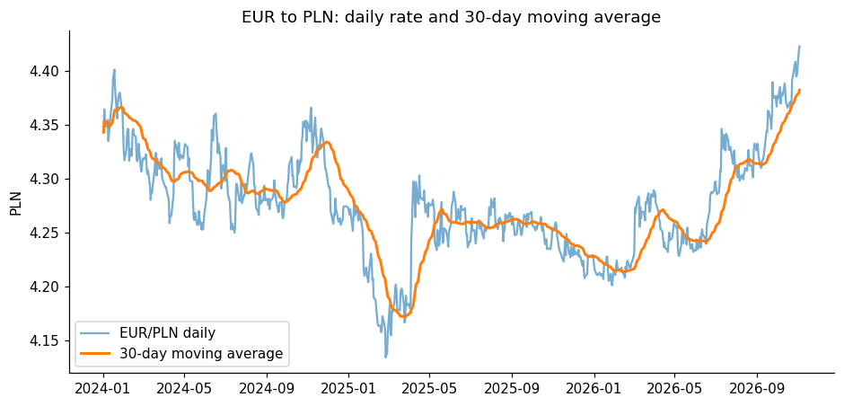

# Automated Currency Data Pipeline and Report

A small ETL pipeline that downloads daily exchange rates from a public REST API, cleans them, stores them in a SQL database and builds a report with charts. One command runs everything, and a repeated run only downloads new days.

**Tools:** Python (requests, pandas, matplotlib), SQL (SQLite), pytest

**Data source:** National Bank of Poland (NBP) public API, table A: average daily exchange rates of EUR, USD, GBP and CHF against the Polish zloty (PLN). No API key is needed.

## How it works

```
NBP REST API  ->  extract  ->  transform  ->  load  ->  report
   (JSON)        raw JSON     clean table    SQLite    charts, CSV, summary
```

| Step | File | What it does |
|---|---|---|
| Extract | `pipeline/extract.py` | Calls the API in chunks (the API allows 367 days per request), retries on network errors, saves every raw response to `data/raw/` |
| Transform | `pipeline/transform.py` | Flattens nested JSON into a table, fixes types, removes duplicates and invalid rates |
| Load | `pipeline/load.py` | Writes to SQLite with a primary key on (date, currency), so running twice never creates duplicates. Finds the last stored date and downloads only newer data |
| Report | `pipeline/report.py` | SQL queries with window functions (30-day moving average, daily change with `LAG`), monthly statistics, volatility, charts and a markdown summary |
| Run | `run_pipeline.py` | Runs all steps from the command line |
| Tests | `tests/test_pipeline.py` | Tests for date splitting, data cleaning and repeatable loading |

## How to run

```
pip install -r requirements.txt
python3 run_pipeline.py
```

Options:
```
python3 run_pipeline.py --currencies EUR USD --start 2025-01-01
python3 run_pipeline.py --full        # reload the whole range
python3 -m pytest                     # run the tests
```

The first run downloads everything from 2024-01-01. Later runs download only the new days.

## Output (folder `reports/`)
- `summary.md`: table with start and end rate, change, minimum, maximum and volatility per currency
- `rates_daily.csv`: clean daily data with 30-day moving average and daily change (ready to use in Tableau Public, Looker Studio or Power BI)
- `rates_monthly.csv`: monthly average, minimum and maximum
- charts: `01_rates_indexed.png`, `02_moving_average.png`, `03_volatility.png`




## SQL used in the report
- `AVG(...) OVER (PARTITION BY code ORDER BY date ROWS BETWEEN 29 PRECEDING AND CURRENT ROW)` for the 30-day moving average
- `LAG(...) OVER (PARTITION BY code ORDER BY date)` for the daily percentage change
- `GROUP BY` on month for monthly statistics

## Automation
The pipeline can be scheduled to run every weekday, for example with cron on macOS or Linux:
```
0 17 * * 1-5 cd /path/to/project && python3 run_pipeline.py
```

## Limitations
- Table A contains average rates published on working days only, so weekends and holidays have no rows.
- SQLite is used for simplicity; for larger data or several users a server database (PostgreSQL, SQL Server) would be a better choice.
- The report describes past exchange rates only and does not forecast them.
